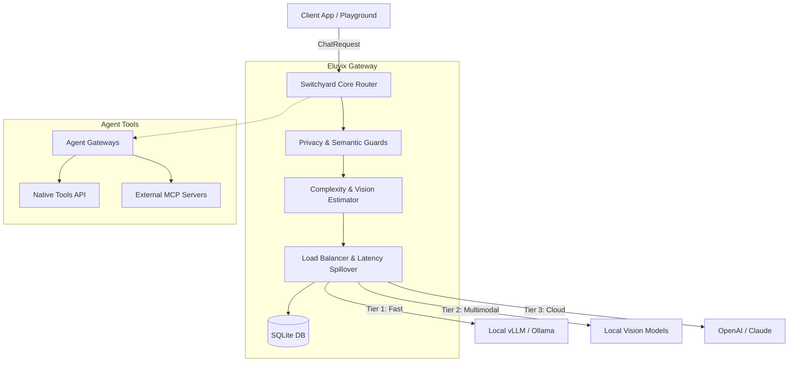

# Eluvix

**Eluvix** is an intelligent, privacy-first, multimodal LLM routing gateway and orchestration UI. It unifies local hardware (vLLM, Ollama, Lemonade) and cloud fallbacks (OpenAI, Anthropic) into a single resilient endpoint.

---

## 🌟 Key Features (Phases 1-4)

- **Cost-Complexity Routing**: Dynamically grades incoming prompts based on reasoning depth and token length, seamlessly routing simple tasks to local GPUs and complex tasks to frontier cloud models.
- **Multimodal Support (Vision)**: Automatically detects image payloads and filters upstreams to strictly target Vision-capable nodes.
- **Latency Spillover & Failover**: Monitors its own SQLite logs for latency spikes. If a local node lags (>3000ms) or crashes, Eluvix gracefully falls back to the next tier without dropping the request.
- **Privacy & Security Guards**: Intercepts requests to strip PII (SSNs, API keys, IP addresses) and heuristically blocks prompt injections before they hit the LLM.
- **Native Tools & MCP Injection**: Drag-and-drop tool wiring via the UI. Supports the open Model Context Protocol (MCP) and bundles native tools (WebScraper, Calculator) out of the box.
- **JSONL Fine-Tuning Export**: Chat histories from the integrated Trace Playground are persisted in SQLite and can be exported as ready-to-train OpenAI JSONL datasets.

---

## 🏗️ Architecture



---

## 🚀 Quickstart

### Prerequisites
- [Node.js v18+](https://nodejs.org/)
- [pnpm](https://pnpm.io/)
- Docker (Optional, for production builds)

### 1. Local Development
Clone the repo, install dependencies, and start the Next.js visual dashboard.

```bash
git clone https://github.com/Eluvixrouter/eluvix.git
cd eluvix

# Configure your secure credentials
cp .env.example .env
# Edit .env and set ADMIN_PASSWORD

# Install dependencies and run
pnpm install
pnpm dev
```
Navigate to `http://localhost:3588` to access the visual routing editor, trace playground, and analytics.

### 2. Cloud Production Deployment
Eluvix is optimized for Docker.

```bash
docker compose -f docker-compose.prod.yml up -d --build
```
This deploys the Next.js frontend in `standalone` mode alongside the background Switchyard engine, persisting your analytics and fine-tuning datasets to the `./data` volume.

---

## 🛠️ Tech Stack
- **Next.js 14** (App Router, React Flow)
- **Tailwind CSS** (Styling)
- **TypeScript**
- **better-sqlite3** (Local low-latency persistence)
- **Vitest** (Unit testing)
