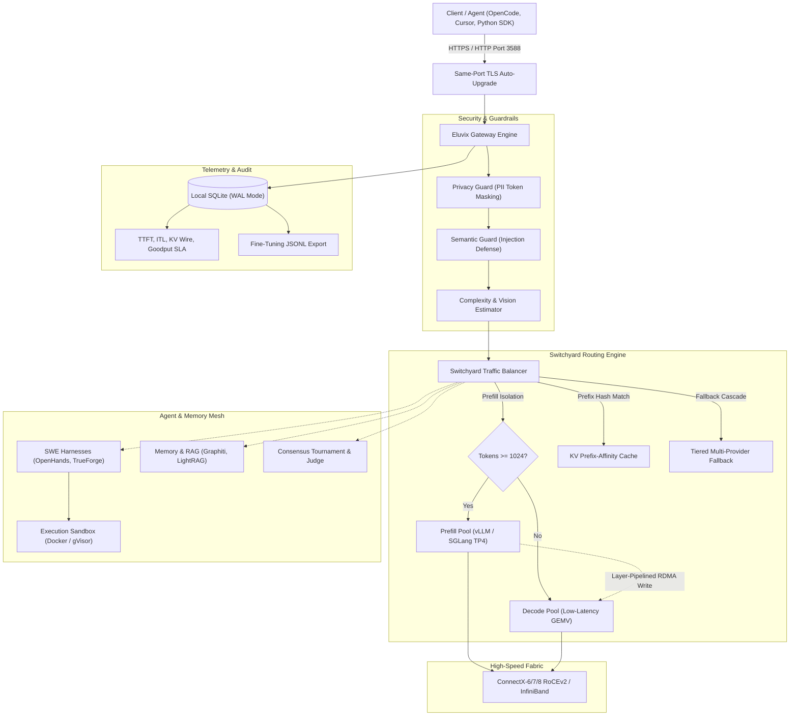

# Eluvix

[](https://www.typescriptlang.org/)
[](https://nodejs.org/)
[](https://nextjs.org/)
[](https://vitest.dev/)
[](LICENSE)

**Eluvix** is an intelligent, sovereign, multimodal AI routing operating system, disaggregated inference coordinator, native MCP server, and visual node studio. It unites on-premises GPU clusters (NVIDIA CUDA or AMD ROCm), local containers, and frontier cloud models behind universal OpenAI (`/v1/chat/completions`, `/v1/responses`, `/v1/embeddings`, `/v1/audio/*`, `/v1/images/generations`), Anthropic (`/v1/messages`), and Model Context Protocol (`/v1/mcp` & `eluvix-mcp` stdio) endpoints.

---

## 🌟 Key Capabilities

- **Prompt Caching, Universal Structured Outputs, Streaming Output Guard DLP & Real OTLP Exporter (v1.2)**: Preserves Anthropic `cache_control` breakpoints and discounts cached input tokens (`X-Eluvix-Cache-Read-Tokens`), enforces `response_format: { type: "json_schema" }` across vLLM (`guided_json`), SGLang, Ollama (`format`), and RamaLama with automatic fence repair and verifier escalation (`X-Eluvix-Schema-Validation`), scans live SSE token streams with a sliding holdback window to redact split-token secrets/PII before reaching the client (`X-Eluvix-Output-Guard`), and exports OpenTelemetry (`OTLP/HTTP JSON` + Langfuse) `gen_ai.*` & `eluvix.*` root/child spans (`X-Eluvix-Trace-Id`).
- **Hashed Scoped Keys, Secret References & Tamper-Evident Audit Chain (v1.2)**: Automatically migrates plaintext `keys.json` tokens in place to SHA-256 `keyHash` + `keyPrefix` with per-key `scopes`, `expiresAt`, `maxDailySpendUsd`, and sliding-window `rpm`; resolves `env:`, `file:`, `bao:` (OpenBao/Vault KV v2), and `keychain:` secret references at outbound request time; and maintains a cryptographically verifiable SHA-256 hash chain in SQLite `audit_events` (`GET /api/v1/audit?verify=1`).
- **Live Engine Load Signals, Batch API, Cross-Encoder Rerank, Prompt Registry & Webhooks (v1.2)**: Scrapes vLLM/SGLang `/metrics`, Ollama `/api/ps` (warm VRAM residency), and ComfyUI `/queue` (`X-Eluvix-Engine-Load`), runs asynchronous OpenAI-compatible `/api/v1/files` & `/api/v1/batches` jobs with `CooperativeVramArbiter` yielding, exposes `POST /api/v1/rerank` (`X-Eluvix-Rerank-Model`), manages versioned system prompts with eval-gated `@production` promotion (`GET/POST /api/v1/prompts`, `X-Eluvix-Prompt`), and dispatches HMAC-SHA256 signed Slack/Discord/ntfy/JSON webhooks (`/api/v1/webhooks`).
- **Universal Wire-Protocol Gateway (`/v1/messages`, `/v1/responses`, `/v1/embeddings`)**: Drop-in support for **Anthropic Claude Code & SDKs** (`/api/v1/messages` with `x-api-key` auth, `thinking_delta`, `tool_use`), **OpenAI Codex CLI & Agents SDK** (`/api/v1/responses` stateful `previous_response_id` chaining in SQLite honoring `store: false`), **Matryoshka Dimension-Pinned Embeddings** (`/api/v1/embeddings`), and automatic vendor model capability-tier aliasing (`claude-*-haiku*` / `*-mini` &rarr; `$0.00` sovereign local `simple`).
- **Speculative Cascades, Online Thompson Bandit & SFT/DPO Distillation**: Dedicated **`SpeculativeCascadeNode`** (`#draft`, `#verifier`, `#shadow-student`) performing buffer-verify confidence checks before SSE flush (zero corrupted half-streams), **`thompson-bandit`** contextual routing backed by SQLite Beta posteriors, async `#shadow-student` mirroring + Playground Arena voting (`POST /api/v1/distillation/vote`), and one-click `chat` / `sft` / `dpo` JSONL export (`GET /api/v1/export`).
- **Dual-Transport Sovereign MCP `2025-06-18` Server (`POST /api/v1/mcp` & `eluvix-mcp` CLI)**: Exposes 7 sovereign tools (`eluvix_route_explain`, `eluvix_list_models`, `eluvix_smart_complete`, `eluvix_memory_query`, `eluvix_memory_store`, `eluvix_privacy_scrub`, `eluvix_generate_image`) and redacted `eluvix://` resources over Streamable-HTTP and pure-NDJSON `stdio` with `x-eluvix-hops` loop protection.
- **Headless Sovereign Audio (`AudioVoiceNode`) & Cooperative GPU VRAM Arbiter**: OpenAI-compatible `POST /api/v1/audio/transcriptions` (Speaches Faster-Whisper `:8005` / `whisper.cpp`) and `POST /api/v1/audio/speech` (Kokoro-FastAPI `:8880` / Piper TTS), plus a **Cooperative GPU VRAM Arbiter** that cleanly unloads idle Ollama models (`keep_alive: 0`) before ComfyUI renders and frees idle ComfyUI VRAM (`POST /free`) before LLM inference without ever stopping containers.
- **Golden Eval Suites (`eluvix-eval` CLI & In-Editor `EvalGateDrawer`)**: Verify routing assertions, PII redaction, and prompt-injection blocks at `$0.00` cost (`mode: "dry-run"`) or live upstream regex checks (`mode: "live"`) via `POST /api/v1/evals/run`, `npx eluvix-eval run suite.json` (CI exit `0`/`1`), or **Verify Before Apply** inside `/editor`.
- **Gemini 4 Carbon First-Class Support (1M Context & Granular Effort)**: Flagship integration for `gemini-4-carbon` via Google Antigravity (`agy`) with 1,000,000-token context, 64,000 max output tokens, multimodal vision, and automated thinking effort variants (`-low`, `-medium`, `-high`, `-xhigh`, `-max`).
- **ComfyUI Local Media Synthesis (`:8188`) & Modality-Aware Switchyard**: Generates sovereign images, video clips, and 3D meshes via an OpenAI-compatible `POST /v1/images/generations` endpoint backed by ComfyUI workflow DAGs (`flux-txt2img`, `sdxl-txt2img`, `wan21-txt2vid`, `hunyuan3d-mesh`), with automated modality intent isolation on `model: "auto"` and an SSRF-guarded HTTPS media proxy.
- **RamaLama Rootless OCI Containers (`:8080`)**: Deploys GGUF models inside rootless Podman/Docker containers with systemd Quadlet `.container` unit generation, `--rag` OCI knowledge binding, SELinux confinement, and `--network=none` air-gapping.
- **Eluvix Visual Node Routing Editor Pro Studio (`/editor`)**: 30+ specialized nodes with **Spotlight Command Palette (`Cmd+K`)**, **50-state deep Undo/Redo (`Cmd+Z`)**, **Deterministic Sugiyama Topological Auto-Layout**, **Interactive Live Route Simulator** (emerald/amber animated edge overlays), **Golden Eval Gate (`🧪 Evals`)**, and **One-Click Diagnostic Auto-Fix**.
- **Playground 2.0**: Multimodal evaluation studio with **real-time SSE streaming speedometer (TTFT ms & tok/s)**, **drag-and-drop/clipboard Vision attachments**, **ComfyUI Image & Media Studio**, **A/B Split Arena with DPO Preference Voting**, and collapsible `<think>` reasoning accordions.
- **Observability 2.0 & Rolling 24h Cloud Spend Guardrails**: Native **Prometheus `0.0.4` metrics exposition (`/api/v1/metrics`)** (including `eluvix_vram_evictions_total` & `eluvix_vram_active_workloads`), rolling 24-hour cloud spend caps in SQLite (`maxDailySpendUsd`), `prefer-local` / `strict-local` / `reject` guardrails, `X-Eluvix-Budget-Fallback: local-sovereign` headers, and a live 24h Spend Meter in `/observability`.
- **Zero-Trust Confidential Silicon (AMD SEV-SNP / Intel TDX / NVIDIA H100 & B200 CC)**: Enforces hardware-attested TEE routing (`require-dual-attestation`, `require-tee`, `prefer-tee`), verifying **VMPL 0**, **Restricted Injection (`#HV`)**, **384-bit Launch Measurements**, **NVIDIA SPDM 1.2 RIMs**, and **512-bit `REPORT_DATA` binding** (`SHA512(nonce || ephemeral_pubkey)`) with fail-closed HTTP 503 protection and encrypted `tmpfs` model weight unsealing.
- **Disaggregated LLM Serving (RDMA / RoCEv2)**: Separates compute-bound prompt Prefill ($>2,048\text{ FLOPs/Byte}$) from memory-bound auto-regressive Decode ($16\text{–}32\text{ FLOPs/Byte}$) across 100G/200G/400G/800G fabrics using **vLLM NIXL** and **SGLang Mooncake** layer-pipelined connectors.
- **DeepSeek MLA & GQA KV-Cache Modeling**: Built-in KV-footprint math modeling Grouped-Query Attention ($160\text{ KiB/tok}$ in FP8) vs. DeepSeek Multi-Head Latent Attention ($34.3\text{ KiB/tok}$ in FP8, a **$4.66\times$ compression**).
- **Switchyard Prefill-Isolation & Prefix Affinity**: Steers heavy prompts ($\ge 1,024$ tokens) to dedicated prefill workers to eliminate the time-to-first-token bubble, and hashes static system prompt prefixes to pin repeated requests to warm PagedAttention/RadixAttention GPU cache.
- **Split TTFT vs. ITL Telemetry**: Measures Time to First Token (TTFT) and Inter-Token Latency (ITL) per request, tracking real-time **SLA Goodput %** ($\text{TTFT} \le 1,500\text{ms}, \text{ITL} \le 30\text{ms/tok}$).
- **Autonomous Agent & SWE Harness Mesh**: First-class gateways for coding agents including **OpenHands**, **Devin**, **SWE-bench**, **TrueForge**, and **Antigravity**, coupled with isolated **Sandboxes** (Docker, gVisor, Firecracker).
- **Stateful Memory & RAG**: Temporal knowledge graphs (**Graphiti**), semantic preference memory (**Mem0**, **Letta**), dual-level RAG (**LightRAG**), and sub-millisecond **Semantic Caching**.
- **Privacy & Prompt Injection Defense**: In-flight PII masking/blocking (API keys, SSNs, credit cards, emails) and heuristic semantic prompt injection defense.
- **Dual-Protocol Same-Port TLS Auto-Upgrade**: Userspace first-byte demuxing on port `3588` (`apps/nextjs/server.mjs`: a Node `net` server reads the first byte — `0x16` TLS ClientHello goes to the HTTPS server, anything else to the HTTP server). Plaintext HTTP **browser navigation** receives an `HTTP 308` redirect to HTTPS on the exact same port; `/api/` requests on port 3588 are served directly over plain HTTP by design, so API clients must use `https://127.0.0.1:3588`.
- **Interactive Roofline & RDMA Lab**: Client-side simulator on `/provider` modeling arithmetic intensity, network wire time, layer overlap %, and exposed TTFT overhead across hardware architectures.
- **Monetize Idle Compute**: Decentralized Billama Provider daemon allowing developers to sell idle GPU compute time with instant consumer preemption.

---

## 🏗️ System Architecture



---

## 🧩 Visual Routing Studio & Templates

The interactive node editor at `https://127.0.0.1:3588/editor` provides drag-and-drop orchestration with 22 bundled production templates:

| Template | Focus | Key Nodes Included |
| :--- | :--- | :--- |
| **Zero-Trust Confidential Enclave** | Hardware TEE Attestation | Confidential Enclave (`require-dual-attestation`), Switchyard, vLLM SEV-SNP + H100 CC-On, SGLang TDX + B200 TEE-I/O |
| **Disaggregated RDMA Cluster** | Ultra-Low-Latency Serving | Switchyard (`prefill-isolation`), vLLM Prefill (NIXL), vLLM Decode, SGLang Mooncake |
| **Consensus RAG & SWE Mesh** | Autonomous Coding & Quality | OpenHands Harness, Docker Sandbox, Graphiti Memory, Consensus Judge Arena |
| **Full Production Stack** | Sovereign Defense & Hybrid | Privacy Guard, Semantic Guard, Switchyard, Local Engines, Cloud Fallback |
| **Privacy First Zero-Trust** | Air-Gapped Data Protection | Strict PII Anonymization, Prompt Injection Defense, Local vLLM/Ollama only |
| **High-Throughput Batching** | Heavy Workload Processing | Semantic Cache, Fallback Chain, High-Priority Engine Clusters |

---

## 🚀 Quickstart

### Prerequisites
- **Node.js**: `v22.13.0+ LTS` (uses built-in `node:sqlite` and native ESM)
- **pnpm**: `v11.0.0+`
- **GPU Acceleration (Optional)**: NVIDIA CUDA (Driver 535+) or AMD ROCm 6.2+
- **Docker & Compose**: `v2.20+` (for containerized deployments)

### 1. Local Development
```bash
# 1. Clone repository
git clone https://github.com/Eluvixrouter/eluvix.git
cd eluvix

# 2. Configure credentials
cp .env.example .env
# Edit .env and set your ADMIN_PASSWORD

# 3. Install dependencies & build core
pnpm install
pnpm dev
```
Open **`https://127.0.0.1:3588`** in your browser.

### 2. Modular Docker Compose Deployment
Eluvix features a split, pick-and-choose compose architecture in `docker/compose/`:

```bash
# Start Core Gateway & UI only
docker compose -f docker/compose/core.yml up -d

# Start Core + Local Inference Engines (vLLM & SGLang)
docker compose -f docker/compose/core.yml -f docker/compose/inference.yml up -d

# Start Full Production Mesh (Gateway + Inference + SWE Harnesses + Memory)
docker compose \
  -f docker/compose/core.yml \
  -f docker/compose/inference.yml \
  -f docker/compose/harnesses.yml \
  -f docker/compose/memory.yml \
  up -d
```

---

## 📖 Documentation Index

- [**System Architecture Deep Dive**](docs/architecture.md): Request pipeline, complexity scoring, and failover mechanics.
- [**Zero-Trust Confidential Silicon (TEE)**](docs/confidential-computing-tee.md): AMD SEV-SNP RMP, Intel TDX S-EPT, NVIDIA H100 `SWIOTLB` vs. B200 `TEE-I/O`, and IETF RATS Dual-Attestation.
- [**Disaggregated Serving & RDMA Fabrics**](docs/disaggregated-serving-rdma.md): Roofline math, DeepSeek MLA compression, NIXL/Mooncake pipelining, and RoCEv2 tuning.
- [**Next-Gen Routing Nodes & Agent Mesh**](docs/next-gen-nodes.md): Harness, Memory, Sandbox, KnowledgeBase, Consensus, and Fallback nodes.
- [**Modular Docker Compose Guide**](docs/docker-modular-compose.md): Pick-and-choose deployment recipes and profile management.
- [**Interactive Web Docs**](apps/nextjs/src/app/docs/docs-data.ts): Built-in in-app documentation at `https://127.0.0.1:3588/docs`.

---

## 🧪 Testing & Verification

Eluvix maintains a comprehensive test suite across the monorepo:

```bash
# Test router core (40 test files, 314 tests)
pnpm --filter @eluvix/router-core test

# Test Next.js application & Eluvix Visual Node Routing Editor (20 test files, 165 tests)
pnpm --filter nextjs test

# Run Golden Routing & Security Regression Eval Suite from CLI
npx eluvix-eval run suite.json

# Run full monorepo production build (60 Vitest suites / 479 tests)
pnpm build
```

---

## ⚖️ License
Licensed under the [MIT License](LICENSE).
