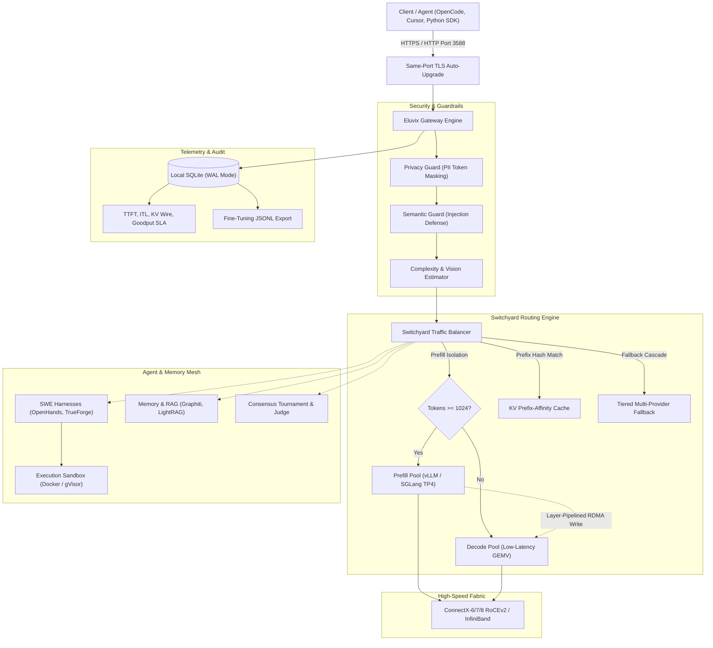

# Eluvix

[](https://www.typescriptlang.org/)
[](https://nodejs.org/)
[](https://nextjs.org/)
[](https://vitest.dev/)
[](LICENSE)

**Eluvix** is an intelligent, sovereign, multimodal LLM routing gateway, disaggregated inference coordinator, and visual node studio. It unites on-premises GPU clusters (NVIDIA CUDA or AMD ROCm) and frontier cloud models into a single resilient OpenAI-compatible endpoint.

---

## 🌟 Key Capabilities

- **Zero-Trust Confidential Silicon (AMD SEV-SNP / Intel TDX / NVIDIA H100 & B200 CC)**: Enforces hardware-attested TEE routing (`require-dual-attestation`, `require-tee`, `prefer-tee`), verifying **VMPL 0**, **Restricted Injection (`#HV`)**, **384-bit Launch Measurements**, **NVIDIA SPDM 1.2 RIMs**, and **512-bit `REPORT_DATA` binding** (`SHA512(nonce || ephemeral_pubkey)`) with fail-closed HTTP 503 protection and encrypted `tmpfs` model weight unsealing.
- **Disaggregated LLM Serving (RDMA / RoCEv2)**: Separates compute-bound prompt Prefill ($>2,048\text{ FLOPs/Byte}$) from memory-bound auto-regressive Decode ($16\text{–}32\text{ FLOPs/Byte}$) across 100G/200G/400G/800G fabrics using **vLLM NIXL** and **SGLang Mooncake** layer-pipelined connectors.
- **DeepSeek MLA & GQA KV-Cache Modeling**: Built-in KV-footprint math modeling Grouped-Query Attention ($160\text{ KiB/tok}$ in FP8) vs. DeepSeek Multi-Head Latent Attention ($34.3\text{ KiB/tok}$ in FP8, a **$4.66\times$ compression**).
- **Switchyard Prefill-Isolation & Prefix Affinity**: Steers heavy prompts ($\ge 1,024$ tokens) to dedicated prefill workers to eliminate the time-to-first-token bubble, and hashes static system prompt prefixes to pin repeated requests to warm PagedAttention/RadixAttention GPU cache.
- **Split TTFT vs. ITL Telemetry**: Measures Time to First Token (TTFT) and Inter-Token Latency (ITL) per request, tracking real-time **SLA Goodput %** ($\text{TTFT} \le 1,500\text{ms}, \text{ITL} \le 30\text{ms/tok}$).
- **Autonomous Agent & SWE Harness Mesh**: First-class gateways for coding agents including **OpenHands**, **Devin**, **SWE-bench**, **TrueForge**, and **Antigravity**, coupled with isolated **Sandboxes** (Docker, gVisor, Firecracker).
- **Stateful Memory & RAG**: Temporal knowledge graphs (**Graphiti**), semantic preference memory (**Mem0**, **Letta**), dual-level RAG (**LightRAG**), and sub-millisecond **Semantic Caching**.
- **Privacy & Prompt Injection Defense**: In-flight PII masking/blocking (API keys, SSNs, credit cards, emails) and heuristic semantic prompt injection defense.
- **Dual-Protocol Same-Port TLS Auto-Upgrade**: In-kernel TCP byte-sniffing on port `3588`. Plaintext HTTP clients receive an instant `HTTP 308` redirect to HTTPS on the exact same port without proxy overhead.
- **Interactive Roofline & RDMA Lab**: Client-side simulator on `/provider` modeling arithmetic intensity, network wire time, layer overlap %, and exposed TTFT overhead across hardware architectures.
- **Monetize Idle Compute**: Decentralized Billama Provider daemon allowing developers to sell idle GPU compute time with instant consumer preemption.

---

## 🏗️ System Architecture



---

## 🧩 Visual Routing Studio & Templates

The interactive node editor at `https://127.0.0.1:3588/editor` provides drag-and-drop orchestration with 16 bundled production templates:

| Template | Focus | Key Nodes Included |
| :--- | :--- | :--- |
| **Zero-Trust Confidential Enclave** | Hardware TEE Attestation | Confidential Enclave (`require-dual-attestation`), Switchyard, vLLM SEV-SNP + H100 CC-On, SGLang TDX + B200 TEE-I/O |
| **Disaggregated RDMA Cluster** | Ultra-Low-Latency Serving | Switchyard (`prefill-isolation`), vLLM Prefill (NIXL), vLLM Decode, SGLang Mooncake |
| **Consensus RAG & SWE Mesh** | Autonomous Coding & Quality | OpenHands Harness, Docker Sandbox, Graphiti Memory, Consensus Judge Arena |
| **Full Production Stack** | Sovereign Defense & Hybrid | Privacy Guard, Semantic Guard, Switchyard, Local Engines, Cloud Fallback |
| **Privacy First Zero-Trust** | Air-Gapped Data Protection | Strict PII Anonymization, Prompt Injection Defense, Local vLLM/Ollama only |
| **High-Throughput Batching** | Heavy Workload Processing | Semantic Cache, Fallback Chain, High-Priority Engine Clusters |

---

## 🚀 Quickstart

### Prerequisites
- **Node.js**: `v22.13.0+ LTS` (uses built-in `node:sqlite` and native ESM)
- **pnpm**: `v11.0.0+`
- **GPU Acceleration (Optional)**: NVIDIA CUDA (Driver 535+) or AMD ROCm 6.2+
- **Docker & Compose**: `v2.20+` (for containerized deployments)

### 1. Local Development
```bash
# 1. Clone repository
git clone https://github.com/Eluvixrouter/eluvix.git
cd eluvix

# 2. Configure credentials
cp .env.example .env
# Edit .env and set your ADMIN_PASSWORD

# 3. Install dependencies & build core
pnpm install
pnpm dev
```
Open **`https://127.0.0.1:3588`** in your browser.

### 2. Modular Docker Compose Deployment
Eluvix features a split, pick-and-choose compose architecture in `docker/compose/`:

```bash
# Start Core Gateway & UI only
docker compose -f docker/compose/core.yml up -d

# Start Core + Local Inference Engines (vLLM & SGLang)
docker compose -f docker/compose/core.yml -f docker/compose/inference.yml up -d

# Start Full Production Mesh (Gateway + Inference + SWE Harnesses + Memory)
docker compose \
  -f docker/compose/core.yml \
  -f docker/compose/inference.yml \
  -f docker/compose/harnesses.yml \
  -f docker/compose/memory.yml \
  up -d
```

---

## 📖 Documentation Index

- [**System Architecture Deep Dive**](docs/architecture.md): Request pipeline, complexity scoring, and failover mechanics.
- [**Zero-Trust Confidential Silicon (TEE)**](docs/confidential-computing-tee.md): AMD SEV-SNP RMP, Intel TDX S-EPT, NVIDIA H100 `SWIOTLB` vs. B200 `TEE-I/O`, and IETF RATS Dual-Attestation.
- [**Disaggregated Serving & RDMA Fabrics**](docs/disaggregated-serving-rdma.md): Roofline math, DeepSeek MLA compression, NIXL/Mooncake pipelining, and RoCEv2 tuning.
- [**Next-Gen Routing Nodes & Agent Mesh**](docs/next-gen-nodes.md): Harness, Memory, Sandbox, KnowledgeBase, Consensus, and Fallback nodes.
- [**Modular Docker Compose Guide**](docs/docker-modular-compose.md): Pick-and-choose deployment recipes and profile management.
- [**Interactive Web Docs**](apps/nextjs/src/app/docs/docs-data.ts): Built-in in-app documentation at `https://127.0.0.1:3588/docs`.

---

## 🧪 Testing & Verification

Eluvix maintains a comprehensive test suite across the monorepo:

```bash
# Test router core (17 test files, 169 tests)
pnpm --filter @eluvix/router-core test

# Test Next.js application & layout store (12 test files, 121 tests)
pnpm --filter nextjs test

# Run full monorepo production build
pnpm build
```

---

## ⚖️ License
Licensed under the [MIT License](LICENSE).
