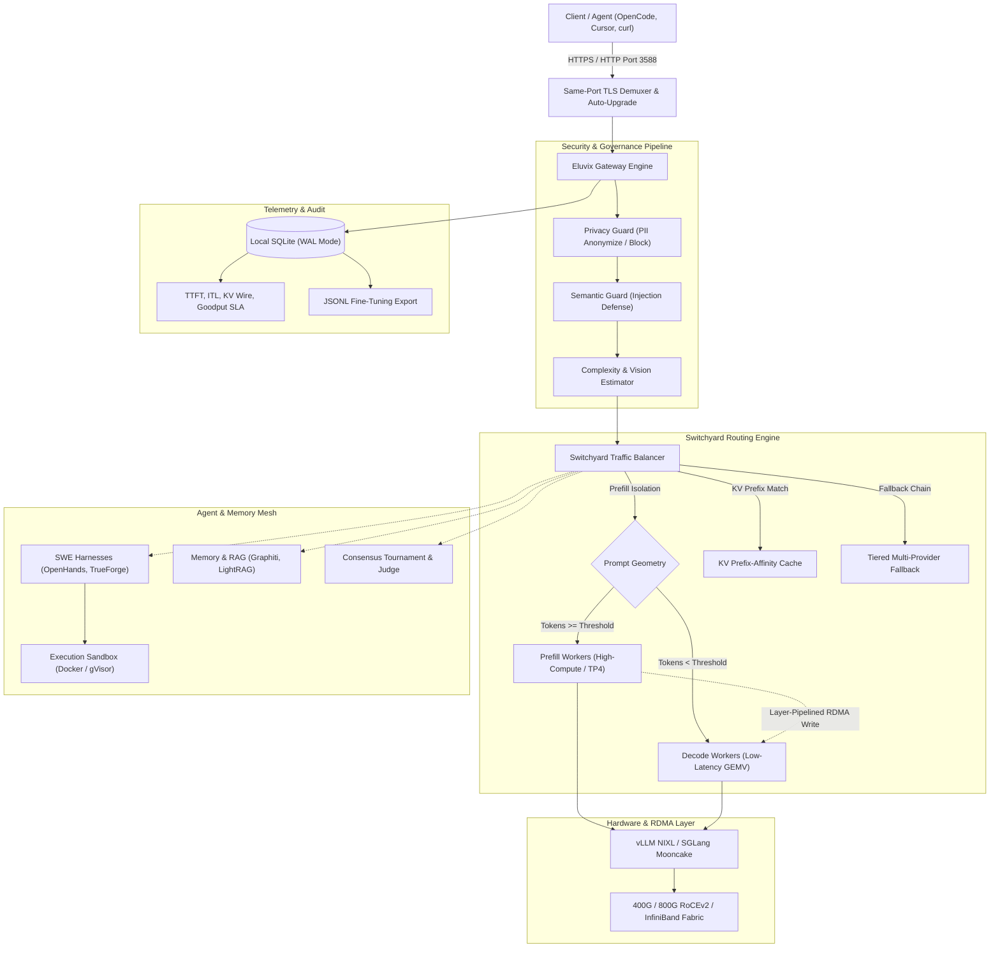
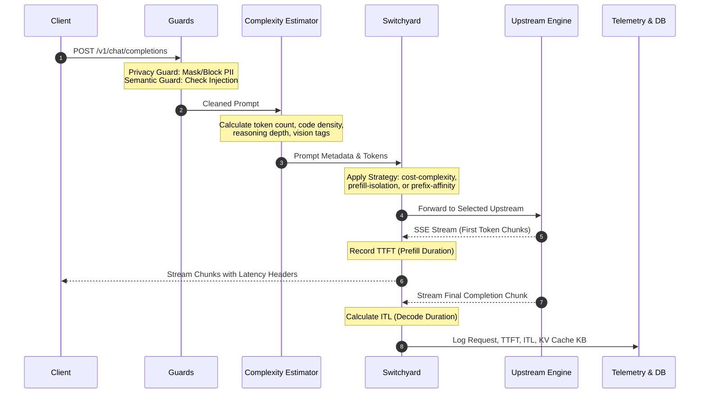

# Eluvix System Architecture

Eluvix is a sovereign, multimodal LLM routing gateway, disaggregated inference coordinator, and agentic orchestration studio. It bridges local GPU clusters (NVIDIA CUDA or AMD ROCm) and frontier cloud models into a resilient OpenAI-compatible endpoint.

---

## 1. High-Level Architecture Overview

---

## 2. Request Lifecycle Pipeline

Every request arriving at `https://127.0.0.1:3588/api/v1/chat/completions` undergoes an authoritative 7-stage processing lifecycle:

1. **Dual-Protocol TLS Sniffing (Port 3588)**:
   The TCP listener inspects the initial byte of incoming connections. Plaintext HTTP clients receive an instant `HTTP/1.1 308 Permanent Redirect` to HTTPS on the exact same port; TLS handshakes terminate immediately without proxy overhead.
2. **Privacy Guard**:
   Scans incoming payloads for Personally Identifiable Information (PII) including API keys, Social Security Numbers, credit cards, emails, and IP addresses. Configurable to `anonymize` with masked tokens (e.g. `[REDACTED_SSN]`) or `block` with HTTP 400.
3. **Semantic Guard**:
   Heuristically analyzes prompt structures for prompt injection, system instruction overrides, jailbreaks, and delimiter escapes.
4. **Complexity & Vision Assessment**:
   Evaluates prompt token volume, code block presence, schema complexity, and reasoning requirements, assigning a Complexity Score (1: Simple, 2: Moderate, 3: Heavy, 4: Frontier). Flags multimodal `image_url` payloads.
5. **Switchyard Target Filtering & Sorting**:
   - Eliminates upstreams lacking the requested model (unless wildcard `*` is configured).
   - If image payloads exist, restricts targets to `vision`-capable nodes.
   - Applies **Prefill-Isolation**: Prompts exceeding `prefillIsolationThresholdTokens` (default 1,024) are routed to prefill workers.
   - Applies **KV Prefix Affinity**: Requests sharing static system prompts are routed to the specific worker caching the warm KV blocks.
   - Evaluates rolling SQLite latency averages: nodes exceeding `3000ms` or reporting degraded status are penalized.
6. **Execution & Resilient Failover**:
   Forwards request to target upstream. If a local model fails (GPU out-of-memory, timeout, connection reset), Switchyard catches the error and cascades to the next fallback tier (e.g., secondary local or cloud).
7. **Telemetry & Header Emission**:
   Emits `x-eluvix-ttft-ms`, `x-eluvix-itl-ms`, `x-eluvix-kv-cache-kb`, and `x-eluvix-upstream` headers and records audit logs to SQLite.

---

## 3. Disaggregated LLM Serving & RDMA Coordination

To resolve the fundamental conflict between compute-bound prefill and memory-bound decode, Eluvix coordinates multi-node disaggregation:

- **Mathematical Foundations**:
  - Dense FP8 Roofline ridge point on NVIDIA H100 SXM5: $295.3\text{ FLOPs/Byte}$.
  - GQA KV footprint (Llama-3.3-70B): $160\text{ KiB/token}$ in FP8 ($640\text{ MiB}$ for 4k tokens).
  - DeepSeek MLA footprint (DeepSeek-V3): $34.31\text{ KiB/token}$ in FP8 ($137.25\text{ MiB}$ for 4k tokens) — a **$4.66\times$ compression**.
- **Layer-Pipelined Overlap**:
  - Connectors (**vLLM NIXL** and **SGLang Mooncake**) stream KV tensors over RoCEv2/InfiniBand layer by layer as forward passes compute, overlapping $>95\%$ of transfer time and leaving only $\sim 1\text{–}2\text{ms}$ exposed latency.
- **Hardware Probing**:
  - Provider subsystem inspects `nvidia_peermem`, Mellanox ConnectX IB devices, Lossless RoCE PFC/ECN (DSCP priority 3 / TOS 106), and PCIe ACS peer-to-peer DMA support.

---

## 4. Agent Gateways, Sandboxing & SWE Harnesses

Eluvix treats autonomous agent frameworks as first-class upstreams:

- **Agent Frameworks Supported**: OpenHands, Devin-compatible APIs, SWE-bench, TrueForge, and Antigravity.
- **Execution Sandboxing**: Isolates tool execution using Docker containers, gVisor syscall filters, or Firecracker microVMs.
- **Tool Context Injection**: Injects external Model Context Protocol (MCP) servers or Eluvix native tools (Calculator, WebScraper) into agent prompts.
- **Consensus & Judge Arena**: Dispatches prompts across multiple models and uses an LLM judge or majority voting to synthesize optimal outputs.

---

## 5. Storage, Observability & Fine-Tuning

- **SQLite WAL Database**: Embedded zero-latency persistent store located at `~/.config/eluvix/telemetry.db` (or `/app/data` in Docker).
  - `request_logs`: Complete audit log with status, latency, TTFT, ITL, token throughput, and KV footprint.
  - `chat_history`: Multi-turn session logs used by the Trace Playground and exported to JSONL format for fine-tuning.
  - `provider_settings` & `provider_jobs`: State for decentralized GPU compute monetization.
- **Observability Dashboard**: Live activity stream computing TTFT/ITL percentiles, SLA Goodput rates, token throughput, and estimated local cost savings.
