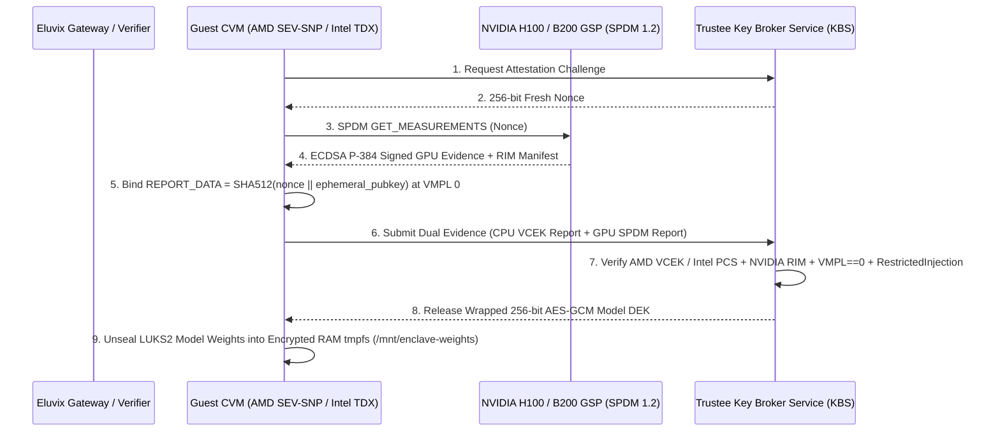

# Zero-Trust Silicon: Confidential Computing with AMD SEV-SNP, Intel TDX & NVIDIA H100/B200 CC-Mode Attestation

Eluvix integrates hardware-rooted Confidential Computing across CPU Trusted Execution Environments (**AMD SEV-SNP** and **Intel TDX**) and GPU Trusted Execution Environments (**NVIDIA Hopper H100 `CC-On` / `PPCIE`** and **Blackwell B200 `TEE-I/O`**). This enables zero-trust AI inference where the host hypervisor (`KVM`/`QEMU`), cloud provider root admin, and physical PCIe bus are completely removed from the Trusted Computing Base (TCB).

---

## 1. Zero-Trust Threat Model & Silicon Mitigations

Traditional cloud virtualization assumes a trusted hypervisor (`Ring -1`). In a zero-trust AI deployment—where proprietary 70B+ frontier weights or sensitive healthcare/financial prompts are processed on rented bare-metal or decentralized GPU clouds—a compromised host OS can read guest DRAM via `/dev/mem`, remap nested page tables (`NPT`/`EPT`), inject forged virtualization exceptions (`#VC`/`#VE`), or snoop GPU `BAR1` HBM3 memory over PCIe.

| Attack Vector | Adversary Capability | Hardware Silicon Defense |
| :--- | :--- | :--- |
| **Cold-Boot / Physical DRAM Interposer** | Probe DDR5 bus or dump `/dev/mem` from host kernel | Per-VM **AES-128/256** inline memory encryption keyed inside the AMD Secure Processor (`ASP`) or Intel `MKTME` + 28-bit SHA-3 integrity MACs in DDR5 ECC bits |
| **Hypervisor NPT / EPT Remapping & Replay** | Remap two guest physical pages (`GPA`) to the same host system physical address (`SPA`) | **AMD Reverse Map Table (`RMP`)** / **Intel Secure EPT (`S-EPT`)** enforces strict 1-to-1 `SPA → (ASID, GPA, Validated)` ownership; guest executes `PVALIDATE` / `TDG.MEM.PAGE.ACCEPT` |
| **Forged `#VC` / `#VE` Interrupt Injection (`WeSee` / `Ahoi`)** | Inject synthetic exception vector `29` (`#VC`) or `20` (`#VE`) to trick the guest into leaking CPU registers via `GHCB` / `TDVMCALL` | **AMD Restricted Injection (`#HV`, vector 28)** or **Intel `SEPT_VE_DISABLE`** blocks synthetic hypervisor exception injection |
| **Host `BAR1` / `mmap` GPU VRAM Snooping** | Host root reads model weights or KV cache directly from GPU HBM3 via PCIe `BAR0`/`BAR1` apertures | **NVIDIA GPU System Processor (`GSP`)** hardware MMU firewall locks `BAR0`/`BAR1` (`0xFFFFFFFF` on host read) before host driver initialization |
| **PCIe Bus Interposer / DMA Snoop** | Logic analyzer on PCIe Gen5/Gen6 risers captures Host-to-Device (`H2D`) prompt and KV-cache DMA | **H100 `CC-On`**: Guest `SWIOTLB` bounce buffer + Copy Engine (`CE`) **AES-GCM-256** DMA encryption.<br>**B200 `TEE-I/O`**: Hardware **PCIe Gen6 IDE** + **TDISP** inline TLP encryption |

---

## 2. Hopper H100 (`SWIOTLB` Bounce Buffers) vs. Blackwell B200 (`TEE-I/O` Inline IDE)

### NVIDIA Hopper H100 (`CC-On` / `PPCIE`)
Because PCIe Gen5 controllers in Hopper lack end-to-end link-layer IDE encryption with first-generation SEV-SNP/TDX hosts, H100 `CC-On` encrypts all DMA transfers in software/hardware bounce buffers:
1. Guest CVM allocates a shared, unencrypted **Software I/O Translation Lookaside Buffer (`SWIOTLB`, 512 MB+)** in guest memory.
2. Before initiating a `cudaMemcpyAsync(H2D)` transfer, the guest CPU encrypts the tensor payload using **AES-GCM-256** with a session key negotiated via **DMTF SPDM 1.2** (`ECDSA P-384`) and writes ciphertext + 96-bit IV + 128-bit GMAC tag into the `SWIOTLB`.
3. The GPU **Copy Engine (`CE`)** pulls the ciphertext over PCIe, verifies the GMAC tag in hardware, decrypts the tensor inside the GPU security perimeter, and writes plaintext into protected HBM3 (`CPR`).
- **Performance Profile**: Effective `H2D` bandwidth is capped at **`~8.64 GB/s`** (70 GB cold weight load takes **`~8.1s`** vs `1.3s` bare-metal). Once weights reside in HBM3, single-GPU decode token generation overhead is only **`-5.5%`** (`121.4 tok/s` vs `128.5 tok/s`).

### NVIDIA Blackwell B200 (`TEE-I/O`)
Blackwell B200 eliminates the `SWIOTLB` bounce buffer bottleneck through three hardware specifications:
1. **PCIe Gen6 Integrity and Data Encryption (`IDE`)**: Inline hardware AES-GCM-256 encryption at the PCIe Root Port and GPU Endpoint (`~24.2 GB/s` effective H2D, **`2.9s`** cold 70 GB load).
2. **TDISP (TEE Device Interface Security Protocol)**: Binds the virtual PCIe function directly to the guest CVM memory space so the GPU DMA engine reads directly from encrypted guest RAM.
3. **Inline Encrypted 5th-Gen NVLink (`1.8 TB/s`)**: Encrypts GPU-to-GPU tensor parallelism (`AllReduce`) at line rate, maintaining **`98.6%`** multi-GPU scaling efficiency (compared to `81.4%` on H100 `PPCIE`).

---

## 3. IETF RATS Dual-Attestation & Confidential Weight Unsealing

Before releasing the 256-bit AES-GCM **Model Weight Decryption Key (`DEK`)** or routing sensitive user prompts to an enclave node, Eluvix enforces a cryptographic **Dual-Attestation** handshake based on the **IETF RATS (RFC 9334)** architecture and **Confidential Containers (`Trustee` KBS)**:



### Cryptographic Verification Checks (`verifyDualAttestationReport`)
1. **VMPL Privilege Level (`VMPL == 0`)**: Confirms the attestation report was generated by the innermost guest kernel (`VMPL 0`), preventing a compromised paravisor at `VMPL 1–3` from forging quotes.
2. **Restricted Injection (`RestrictedInjection == true` / `SEPT_VE_DISABLE`)**: Blocks synthetic `#VC`/`#VE` interrupt injection (`WeSee` and `Ahoi` attacks).
3. **384-bit Launch Measurement (`MEASUREMENT` / `MRTD`)**: Matches the SHA-384 digest of the initial guest OVMF firmware, Linux kernel, and `initramfs` against the golden reference value.
4. **GPU SPDM 1.2 RIM Verification**: Validates the GPU VBIOS and GSP firmware hashes against NVIDIA's signed **Reference Integrity Manifest (`RIM`)** and confirms hardware `CC-On` / `PPCIE` / `TEE-I/O` mode.
5. **512-bit `REPORT_DATA` Channel Binding**: Verifies `REPORT_DATA == SHA512(kbs_nonce || ephemeral_pubkey)` to guarantee freshness and prevent replay or MITM relay attacks.

---

## 4. Eluvix Zero-Trust Confidential Routing

### Switchyard Confidential Policies
Configure `switchyard.confidentialPolicy` (or connect a **Confidential Enclave** node in the Visual Routing Studio):
- **`disabled`**: Standard routing across all healthy upstreams.
- **`prefer-tee`**: Prefers attested TEE upstreams when healthy, falling back to standard upstreams if unavailable.
- **`require-tee`**: Enforces hardware CPU + GPU TEE encryption (`sev-snp-h100-cc` or `tdx-b200-tee-io`). Fails closed with `HTTP 503 confidential_enclave_unavailable` if no TEE upstream is available.
- **`require-dual-attestation`**: Enforces full CPU + GPU TEE encryption, `VMPL == 0`, `Restricted Injection (#HV)`, and verified IETF RATS Dual-Attestation (`GRANTED`). Fails closed with `HTTP 503` if any check is missing.

### Per-Request Header Enforcement & Telemetry Headers
Clients can enforce confidential routing on a per-request basis by passing the `x-eluvix-confidential` header:

```bash
curl https://127.0.0.1:3588/api/v1/chat/completions \
  -H "Authorization: Bearer $ELUVIX_API_KEY" \
  -H "Content-Type: application/json" \
  -H "x-eluvix-confidential: require-dual-attestation" \
  -d '{
    "model": "auto",
    "messages": [
      {"role": "user", "content": "Analyze this confidential clinical genomic sequence..."}
    ]
  }'
```

Responses routed through a confidential enclave emit cryptographic posture headers:
- `x-eluvix-tee-posture`: `DUAL_ATTESTED_ENCLAVE` | `CPU_ONLY_TEE` | `COMPROMISED_OR_PLAINTEXT`
- `x-eluvix-tee-arch`: `sev-snp-h100-cc` | `tdx-b200-tee-io`
- `x-eluvix-rats-kbs`: `GRANTED` | `DENIED`
