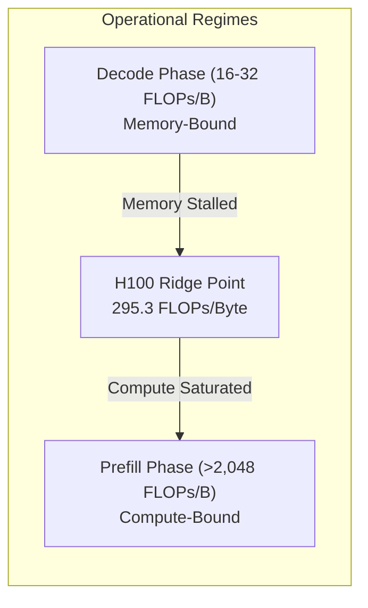
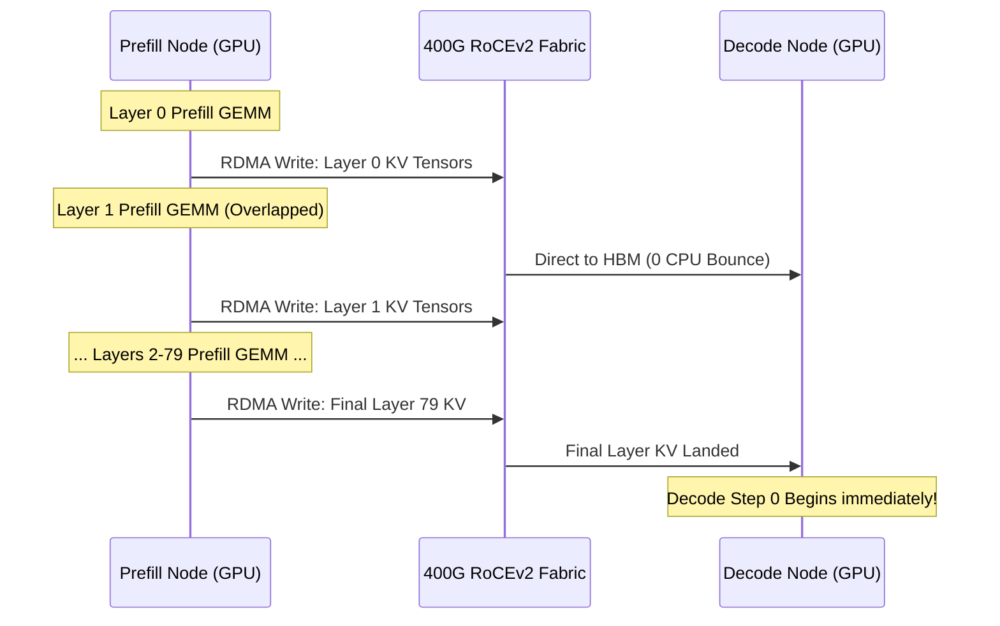

# Disaggregated LLM Serving & RDMA / RoCEv2 Fabrics

Modern LLM inference exhibits two fundamentally distinct operational regimes:

1. **Prompt Prefill Phase**: Highly compute-bound ($>2,048\text{ FLOPs/Byte}$ at 4k+ tokens). Transformer layers process the full input sequence in parallel, fully saturating GPU Tensor Cores.
2. **Auto-Regressive Decode Phase**: Severely memory-bandwidth bound ($16\text{–}32\text{ FLOPs/Byte}$). Weights must be streamed from HBM into on-chip cache once per token generated, leaving Tensor Cores idle while waiting on memory buses.

In traditional **colocated serving** (running Prefill and Decode on the same GPU or worker), incoming long prompts cause **chunked-prefill stalls** and the **time-to-first-token (TTFT) bubble**, stalling interactive token streaming for all concurrent users.

Eluvix introduces **Disaggregated LLM Serving**, separating Prefill and Decode onto dedicated hardware pools interconnected by low-latency **GPUDirect RDMA / RoCEv2** fabrics using **vLLM NIXL** and **SGLang Mooncake** connectors.

---

## 1. Hardware Roofline Modeling

The Roofline Model visualizes the boundary between compute-bound and memory-bound operations on a target GPU:

$$\text{Ridge Point} = \frac{\text{Peak Tensor Compute (FLOPs/s)}}{\text{Memory Bandwidth (Bytes/s)}}$$

### Ridge Points Across Accelerator Architectures

| Accelerator | Peak Dense FP8 / FP16 Compute | HBM3 / GDDR Bandwidth | Roofline Ridge Point |
| :--- | :--- | :--- | :--- |
| **NVIDIA H100 SXM5** | $989.4\text{ TFLOPS}$ (FP8) | $3.35\text{ TB/s}$ (HBM3) | **$295.3\text{ FLOPs/Byte}$** |
| **NVIDIA A100 SXM4** | $312.0\text{ TFLOPS}$ (FP16) | $2.00\text{ TB/s}$ (HBM2e) | **$156.0\text{ FLOPs/Byte}$** |
| **NVIDIA RTX 4090** | $330.0\text{ TFLOPS}$ (FP8) | $1.008\text{ TB/s}$ (GDDR6X) | **$327.4\text{ FLOPs/Byte}$** |



- When arithmetic intensity $< 295.3\text{ FLOPs/Byte}$ (Decode), throughput is bounded strictly by **memory bandwidth**.
- When arithmetic intensity $> 295.3\text{ FLOPs/Byte}$ (Prefill with $>1,024$ prompt tokens), throughput is bounded strictly by **Tensor Core compute**.

Disaggregating workloads allows Prefill workers to run high Tensor Parallelism (e.g. TP4/TP8) with maximal batching, while Decode workers run low-latency streaming without SM interference.

---

## 2. KV-Cache Footprints: GQA vs. DeepSeek MLA

When a Prefill worker completes prompt computation, the generated Key-Value (KV) cache must be transmitted to the target Decode worker. The wire transfer time is dictated by the KV footprint per token.

### Standard Grouped-Query Attention (GQA-8)
For an $L$-layer model with $H_{kv}$ key-value heads, head dimension $D_h$, and element precision $B_{elem}$ (1 byte for FP8, 2 bytes for BF16):

$$\text{KV Bytes / Token} = 2 \times L \times H_{kv} \times D_h \times B_{elem}$$

- **Llama-3.3-70B** ($L=80, H_{kv}=8, D_h=128$):
  - FP8: $2 \times 80 \times 8 \times 128 \times 1 = 163,840\text{ Bytes/token} = \mathbf{160\text{ KiB/token}}$.
  - BF16: $\mathbf{320\text{ KiB/token}}$.
  - For a $4,096$-token prompt, the total KV cache size is $\mathbf{640\text{ MiB}}$ in FP8 ($\mathbf{1,280\text{ MiB}}$ in BF16).

### DeepSeek Multi-Head Latent Attention (MLA)
DeepSeek-V3 and DeepSeek-R1 replace standard KV heads with low-rank latent vector compression ($d_c = 512$) and decoupled rotary position embedding ($d_R = 64$):

$$\text{KV Bytes / Token} = L \times (d_c + d_R) \times B_{elem}$$

- **DeepSeek-V3 / R1** ($L=61, d_c=512, d_R=64$):
  - FP8: $61 \times (512 + 64) \times 1 = 35,136\text{ Bytes/token} = \mathbf{34.31\text{ KiB/token}}$.
  - BF16: $\mathbf{68.62\text{ KiB/token}}$.
  - For a $4,096$-token prompt, the total KV cache size is only $\mathbf{137.25\text{ MiB}}$ in FP8.

$$\text{Compression Ratio} = \frac{160\text{ KiB}}{34.31\text{ KiB}} = \mathbf{4.66\times\text{ reduction in KV size and network wire time}}$$

---

## 3. Pipelined GPUDirect RDMA with NIXL and Mooncake

Traditional network serialization over TCP/IP forces CPU host memory bounces and socket buffer copies, taking $>50\text{ms}$ and stalling the pipeline.

Eluvix uses **layer-by-layer GPUDirect RDMA pipelining** via **vLLM NIXL** and **SGLang Mooncake**:



### Overlap Physics

- Rather than waiting for all 80 layers to finish before starting network transfer, transmission begins immediately as Layer 0 finishes.
- $(L - 1) / L$ of the transfer is completely hidden behind forward-pass matrix multiplication.
- Only the transmission of the final layer plus RDMA setup ($< 1\text{–}2\text{ms}$) is exposed to the client.

### Transfer Duration on High-Speed Fabrics (640 MiB FP8 Cache)

| Fabric Type | Usable Bandwidth | Raw Wire Time | Pipelined Exposed TTFT |
| :--- | :--- | :--- | :--- |
| **100GbE TCP/IP** (No RDMA) | $8.5\text{ GB/s}$ | $75.3\text{ ms}$ | $33.9\text{ ms}$ (Host bounce stall) |
| **200GbE RoCEv2** (ConnectX-6 Dx) | $22.5\text{ GB/s}$ | $28.4\text{ ms}$ | **$0.9\text{ ms}$** |
| **400GbE RoCEv2 / NDR IB** (ConnectX-7) | $47.0\text{ GB/s}$ | $13.6\text{ ms}$ | **$0.7\text{ ms}$** |
| **800GbE RoCEv2 / XDR IB** (ConnectX-8) | $94.0\text{ GB/s}$ | $6.8\text{ ms}$ | **$0.6\text{ ms}$** |

---

## 4. Switchyard Prefill-Isolation & Prefix-Affinity Routing

Eluvix's Switchyard engine ([`packages/router-core`](file:///mnt/unreal/git/eluvix/packages/router-core)) natively understands disaggregation roles and prompt geometry:

### Prefill-Isolation (`prefill-isolation`)
When a request arrives, Switchyard calculates its estimated token count.
- If $\text{Tokens} \ge \text{prefillIsolationThresholdTokens}$ (default 1,024): The request is directed to the **Prefill Pool** or **PD-Disaggregated Cluster**.
- If $\text{Tokens} < \text{prefillIsolationThresholdTokens}$: The prompt is routed to the **Decode Pool** or lightweight colocated workers.

### KV Prefix Affinity
Long-context applications (agent loops, multi-turn coding, RAG contexts) frequently repeat extensive system prompts and retrieved documents.
1. Switchyard extracts the static system prompt or initial context turns.
2. It generates a deterministic SHA-256 hash prefix (`x-eluvix-kv-prefix-hash`).
3. An internal LRU cache maps the prefix hash to the specific worker node that previously computed its KV cache.
4. Subsequent requests with the identical prefix are routed with high affinity to that worker, maximizing **RadixAttention / PagedAttention chunked-prefill cache hit rates** to near $100\%$.

---

## 5. Telemetry & SLA Goodput

Traditional API gateways log a single `duration_ms` value, conflating prompt ingestion with token generation. Eluvix instruments SSE streaming chunks to isolate latency metrics:

- `x-eluvix-ttft-ms`: **Time To First Token** (prefill phase + network transport).
- `x-eluvix-itl-ms`: **Inter-Token Latency** in milliseconds per token (decode phase).
- `x-eluvix-kv-cache-kb`: Estimated KV-cache memory footprint on the GPU.
- `x-eluvix-pd-role`: Upstream node role (`prefill`, `decode`, `colocated`, or `pd-router`).

### SLA Goodput Rate
In production LLM serving, requests that miss interactive latency targets degrade user experience. Eluvix computes **SLA Goodput %**:

$$\text{SLA Goodput} = \frac{\text{Requests with TTFT} \le 1,500\text{ms and ITL} \le 30\text{ms/tok}}{\text{Total Successful Requests}} \times 100\%$$

---

## 6. RoCEv2 / GPUDirect Hardware Setup & Tuning

To achieve lossless line-rate RDMA transfers, the host operating system and network fabric must be tuned. Eluvix provides live hardware detection and remediation snippets in the `/provider` portal:

### 1. Load the NVIDIA Peer Memory Driver
Enables GPUDirect P2P DMA between NICs and GPUs without copying through system RAM:
```bash
sudo modprobe nvidia_peermem
lsmod | grep nvidia_peermem
```

### 2. Verify ConnectX InfiniBand / RoCE Devices
```bash
ibv_devinfo -v
```

### 3. Configure Lossless RoCE (PFC & ECN)
RoCEv2 relies on Priority Flow Control (PFC) on DSCP priority 3 (TOS 106) to guarantee lossless packet transmission:
```bash
# Enable DSCP 26 (TOS 106) on RoCE communication manager
echo 106 | sudo tee /sys/class/infiniband/mlx5_0/tc/1/traffic_class
echo 106 | sudo tee /sys/class/infiniband/mlx5_0/ports/1/cma_roce_tos

# Set Priority Flow Control (PFC) on interface
sudo mlnx_qos -i eth0 --pfc 0,0,0,1,0,0,0,0 --trust dscp
```

### 4. Benchmark Raw Memory Bandwidth
Verify line-rate GPU-to-GPU transfer across the fabric using the Perftest RDMA suite:
```bash
# On Decode Server (Receiver):
ib_write_bw -d mlx5_0 --use_cuda=0 -a -F

# On Prefill Server (Sender):
ib_write_bw -d mlx5_0 --use_cuda=0 -a -F <decode_server_ip>
```

---

## 7. Multi-Node Launch Scripts

Eluvix's Orchestration Compiler generates production startup scripts for multi-node deployments:

### vLLM Multi-Node with NIXL Connector
```bash
# prefill_node_launch.sh
vllm serve meta-llama/Llama-3.3-70B-Instruct \
  --kv-transfer-config '{"kv_connector":"NixlConnector","kv_role":"kv_producer","kv_buffer_device":"mlx5_0"}' \
  --tensor-parallel-size 4 \
  --port 8000

# decode_node_launch.sh
vllm serve meta-llama/Llama-3.3-70B-Instruct \
  --kv-transfer-config '{"kv_connector":"NixlConnector","kv_role":"kv_consumer","kv_buffer_device":"mlx5_0"}' \
  --tensor-parallel-size 4 \
  --port 8001
```

### SGLang Multi-Node with Mooncake Connector
```bash
# sglang_prefill.sh
python3 -m sglang.launch_server \
  --model-path deepseek-ai/DeepSeek-V3 \
  --disaggregation-mode prefill \
  --kv-connector mooncake \
  --radix-attention \
  --tp 4 \
  --port 30000

# sglang_decode.sh
python3 -m sglang.launch_server \
  --model-path deepseek-ai/DeepSeek-V3 \
  --disaggregation-mode decode \
  --kv-connector mooncake \
  --radix-attention \
  --tp 4 \
  --port 30001
```
